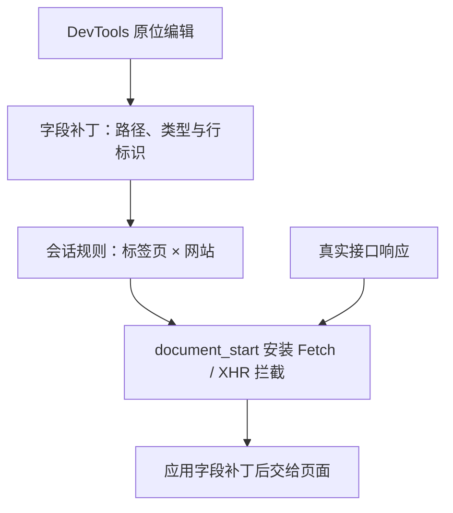

# API Table Viewer

**看清接口数据，直接调整响应。**

Chrome DevTools 中的 JSON 接口调试工具。把响应展开成可搜索的表格和数据树，直接双击字段构造测试数据，让真实页面在下一次请求中使用修改后的响应。

[](https://github.com/Luyii/API-Table-Viewer/actions/workflows/ci.yml)


[快速开始](#快速开始) · [v1.5.1 更新](#v151--浏览交互与捕获稳定性) · [工作原理](#工作原理) · [测试说明](docs/TESTING.md) · [更新记录](CHANGELOG.md)

## v1.5.1 · 浏览交互与捕获稳定性

- **更顺畅地看数据**：数组扁平展开独立于逐行操作，收起后保留一级内容；移除重复 Array 层和嵌套小滚动区，主区域统一滚动，大数据继续按窗口渲染。
- **更直接地操作**：普通字段值单击复制、双击 / F2 编辑；对象与数组点行展开，独立按钮复制完整 JSON，操作区靠右。
- **更多可视空间**：顶部细条一键收起工具区，Ctrl / ⌘+F 可浮动搜索，Esc 关闭。
- **更可靠地捕获**：修正启动监听注册，补充正文重试、HAR 正文与 BOM 识别，增加捕获状态和 localhost 回归。

完整记录见 [更新记录](CHANGELOG.md)。下方保留 v1.5.0 字段响应模拟 的设计介绍。

## v1.5.0 · 原位字段响应模拟

从“看清接口数据”，进一步到“控制页面收到的数据”。

**双击修改 → 自动进入编辑模式 → 重新查询或刷新网页 → 验证页面表现。**

无需修改业务代码，无需额外启动 响应模拟服务，也不必复制整份 JSON。只记录修改字段的路径、类型和值，在真实接口返回后覆盖对应节点。未修改的字段继续使用最新后端数据。

| 能力 | 具体行为 |
| --- | --- |
| 原位编辑 | 表格、数据树和 JSON 查看器中双击标量，或鼠标悬停字段行后按 F2；Enter / 失焦提交，Esc 取消 |
| 修改可追踪 | 轻微底色标记；悬停查看原值；顶部汇总接口数和修改数，支持清单核对、定位和单项恢复 |
| 刷新保留 | 普通刷新、强制刷新、清空捕获列表、重开 DevTools 后继续应用当前标签页的规则 |
| 字段级补丁 | 不在输入时计算整份 JSON diff，不把完整响应作为每次编辑的通信载荷 |
| 稳定数组定位 | 对象数组按唯一 ID / UUID / key 定位，排序变化后仍修改同一条记录；路径或标识失效时跳过 |
| 一键退出 | 清除当前网站的修改规则；后续请求恢复真实响应 |

例如，把 `data.records[0].amount` 从 `128.5` 改为 `-999`，把 `customerName` 改为超长文本，可以直接观察金额样式、异常状态和布局边界。新请求中的库存、时间等其他字段仍由真实后端返回。

> 修改会在网页**下一次请求**时应用。插件不会直接修改 Vue / React 的组件状态；“退出编辑”也不会自动重绘业务页面。请求仍会到达后端，包括 POST 等操作。

完整设计和版本说明见 [v1.5.0 发布说明](docs/RELEASE_v1.5.0.md)。

## 快速开始

1. 下载源码或扩展 ZIP，完整解压到固定目录。
2. 打开 `chrome://extensions`，开启开发者模式，选择“加载已解压的扩展程序”。
3. 选择**直接包含 `manifest.json` 的文件夹**。
4. 打开目标网页 DevTools → **API Table**，刷新网页，选择 JSON 请求。
5. 查看表格或数据树，双击要修改的字段；回到网页重新查询或刷新，观察结果。

更新时替换旧目录、重新加载扩展，再刷新目标网页，以安装新的页面启动脚本。加载失败排查见 [安装说明](docs/INSTALLATION.md)。扩展本身不需要 Node.js、Python 或构建工具。

## 从数据查看到响应模拟

| 场景 | 支持内容 |
| --- | --- |
| 请求捕获 | JSON 响应、已有 Network 记录补录、URL / 方法 / 状态筛选、保留导航记录 |
| 表格分析 | 全数组搜索、匹配高亮与跨页定位、排序、分页、列显隐、自动列宽与拖动调整 |
| JSON 浏览 | 普通数据默认展开；大数据分批遍历、虚拟滚动；字段路径跳转与搜索定位；数组旁符号按钮可扁平展开全部层级 / 恢复一级展示 |
| 长内容查看 | 单元格摘要、完整值弹框、分段文本与完整复制 |
| 请求复现 | 请求详情、请求体 JSON、Bash / WSL / Git Bash 格式 cURL |
| 数据导出 | 原始响应、当前节点、全部筛选和排序后的 CSV / Markdown / JSON |
| 数值精度 | 普通超安全整数字面量精确保留，贯穿浏览、搜索、排序、复制和 JSON 导出 |
| 个性化外观 | 四套配色、自选强调色、数据字号、表格密度和隔行底色；本地记忆，一键恢复默认 |
| 面板布局 | 独立收起左侧列表、拖动分栏、统一滚动条、布局与分页偏好记忆 |

表头字段保持单行，内容自动列宽通常为 88–380 px；手动列宽通常最高 960 px，超长表头可突破上限。长内容省略展示，隐藏列不影响导出。

## 工作原理



- **浏览与修改分离**：Worker 保存原始响应与解析结果。编辑只生成小范围字段补丁，不改写捕获记录，原始数据仍可核对和导出。
- **启动阶段恢复规则**：MAIN world 脚本在 `document_start` 接管主页面 Fetch / XHR，隔离脚本从扩展会话中读取规则。启动请求等待初始化；异常超时回退真实响应。
- **会话隔离**：规则按标签页和页面网站保存，跨站点、跨标签页不混用。关闭标签页、重启浏览器或重新加载扩展后清除。
- **有界的大数据展示**：Worker 解析、分页与搜索；较大子树分批建立索引，只把当前窗口附近的节点交给 DOM。

模块分工、消息流和约束见 [开发与架构](docs/DEVELOPMENT.md)。

## 支持范围与边界

- Chrome 114+、Manifest V3。字段响应模拟 支持主页面 Fetch 和异步 XHR 的 JSON 文本 / JSON 响应；不覆盖 Worker、iframe、WebSocket 或流式协议。
- 接口按**方法与完整 URL（含查询参数）**匹配，不按请求体区分。仅替换已有标量，保持原类型；不新增 / 删除字段，不调整数组结构。
- 对象数组优先使用唯一 `id`、`uuid`、`key` 或以 `Id` 结尾的标识字段。缺少唯一标识时，以不超过 64 KiB 的完整行内容匹配，内容变化或重复时跳过。用于定位的标识本身不允许修改；字段缺失、类型改变或标识失效时跳过，并在网页控制台提示。
- 单响应载入上限 **20 MiB UTF-8**；大于 1 MiB 的响应也可修改小字段。单个编辑字段上限 **64 KiB**，最多 **30 个接口、每接口 200 个字段、1 MiB 规则配置**。
- 捕获缓存最多 **150 条或 80 MiB 原文**。超过 **5,000 节点、500,000 展示字符或 32 层嵌套**的子树需确认后浏览。虚拟滚动减少 DOM 数量，不消除解析和序列化开销。
- 普通超安全整数精确保留；小数、指数形式仍按 JavaScript Number 处理。需要原始写法时使用原始响应复制 / 下载。

## 快捷键

| 按键 | 操作 |
| --- | --- |
| 双击值 / F2 | 原位编辑字段 |
| 编辑时 Enter / Esc | 提交 / 取消本次输入 |
| Ctrl / ⌘ + F | 聚焦当前接口、表格或 JSON 搜索 |
| F3 / Shift + F3 | 下一个 / 上一个匹配 |
| Ctrl / ⌘ + G，配合 Shift | 下一个 / 上一个匹配 |
| 搜索框中 Enter / Shift + Enter | 下一个 / 上一个匹配 |
| Esc | 未编辑字段时关闭弹框 |

焦点需位于扩展面板内；部分系统快捷键可能由 Chrome 优先处理。

## 工程与验证

开发检查需要 Node.js 18+ 和 Python 3，**无需安装项目依赖**。

```sh
npm test
python3 scripts/package.py
python3 tests/package-archive.py
```

| 检查 | 范围 |
| --- | --- |
| 103 项回归 | JSON 解析、精度、排序、搜索、导出、缓存、异步状态与界面逻辑 |
| 8 个 HTTP / Worker 子案例 | 本地接口、较大记录集、长文本与解析联动 |
| 15 项字段响应模拟 检查 | 补丁、稳定行定位、Fetch / XHR、启动请求、会话恢复、隔离、取消与退出 |
| 18 项响应替换回归 | 原替换引擎、规则更新、单次消费、超时释放与控制器 |
| 3 项预览检查 | 示例 HAR、路由、脚本与标识完整性 |
| 资源与压缩包检查 | MV3 清单、资源路径、CSP、脚本作用域、白名单、源文件一致性与解压验证 |

GitHub Actions 在 push / pull_request 时以 Node.js 18、22、24 执行检查，再验证 ZIP。实际运行结果见上方 CI 标记；本地自动检查中的 DOM / Chrome API 模拟不替代真实浏览器验收，详见 [测试说明](docs/TESTING.md)。

`npm run test:manual` 启动本地复现服务，访问 http://127.0.0.1:8765 。`/mock-debug` 提供真实 Fetch / XHR 订单页面，便于验证编辑、刷新保留和退出恢复。步骤见 [Chrome 复现指南](docs/CHROME_REPRO.md)。打包产物为 `dist/API-Table-Viewer-v1.5.1.zip`。

## 文档

[使用说明](docs/USAGE.md) · [安装排查](docs/INSTALLATION.md) · [开发架构](docs/DEVELOPMENT.md) · [测试与发布](docs/TESTING.md) · [v1.5.0 发布说明](docs/RELEASE_v1.5.0.md) · [贡献说明](CONTRIBUTING.md)

## 数据与权限

扩展不上传捕获的数据，不加载远程代码。HTTP / HTTPS 网站访问用于在页面启动时安装请求拦截；`storage` 用于保存当前浏览器会话的字段规则。真实接口通信仍由目标网页发起。cURL、请求详情和导出文件可能包含凭证及业务数据，分享前请检查内容。

项目尚未指定开源许可证；公开仓库不代表授予开源使用许可。
